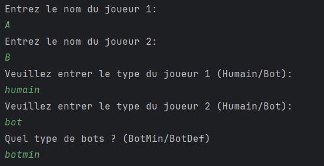
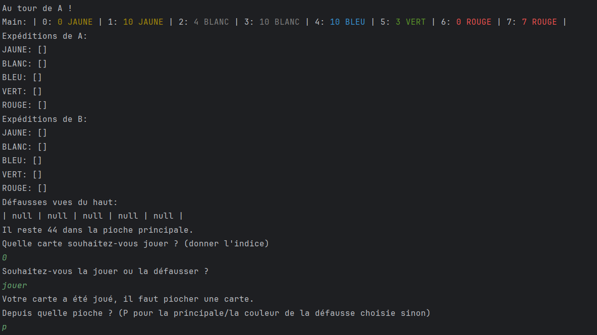
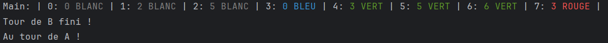
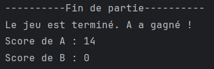
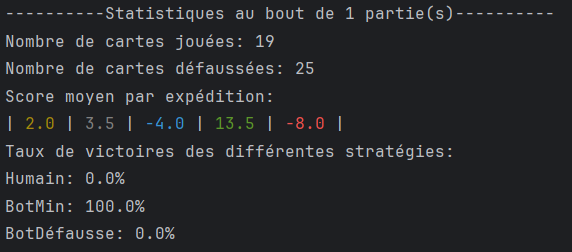

# LostCities BERGER Dorian

- Pour lancer le jeu, il suffit de run le main de la classe LostCities.
- Tout se passe par la suite dans la console ainsi créée.
- Avant que le jeu débute, il vous faudra renseigner le nom des joueurs ainsi que le type des joueurs (Humain, BotMin, BotDéfausse...) avec l'écriture précisée dans les input (les saisies ne sont pas sensibles à la casse).

## A chaque tour de jeu d'un joueur,
- Si le joueur est un "Humain" (stratégie du joueur):
    - Sa main triée sera affichée avec l'indice de chacune des cartes.
    - Les expéditions seront affichées des 2 joueurs seront affichées.
    - Les défausses seront affichées (null si aucune carte n'est encore déposée).

    1) La console demandera au joueur de choisir l'indice de la carte à jouer.
    2) Elle lui demandera s'il veut la jouer ou défausser. Si le choix de la carte ou de la pioche est invalide selon les règle du jeu alors il devra refaire son coup.
    3) Elle lui demandera où piocher la carte.

    Le tour du joueur est terminé et passe au joueur suivant.
    Voici comment cela se déroule:

    

- Si le joueur est un "Bot" (stratégie du joueur):
    - Sa main triée sera également affichée. En théorie, on est pas sensé voir la main de l'adversaire mais on peut souhaiter la garder pour observer le bon fonctionnement de la stratégie du bot choisie afin de faciliter le correction (Cela peut être fait si vous le souhaiter).
    - Les expéditions ne sont pas affichées pour ne pas avoir des lignes de code inutiles dans la console (L'état du jeu final est quand même affiché si la partie se déroule entre 2 bots). Donc l'observation de l'expédition du bot peut se faire au tour du joueur "Humain" pour observer quelle carte le bot a t-il joué.
    - Idem pour les défausses.

    1) Le bot choisie son coup et sa pioche selon sa stratégie en effectuant aucun coup invalide.
        
    Le tour du bot est terminé et passe au joueur suivant.

    

## Quand le jeu est fini

- Affichage du gagnant (ou pas, s'il y a égalité) dans la console.
- Affichage du détail des points.

- Affichage des statistiques (accumulées au fil des parties si plusieurs parties):
    - Nombre de cartes jouéées/défaussées
    - Score moyen par expédition pour un joueur (pas une partie)
    - Taux de victoire pour chacune des stratégie

- Possibilité de rejouer une partie

